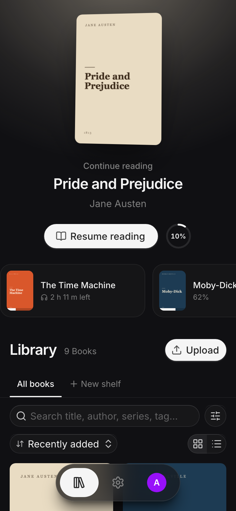
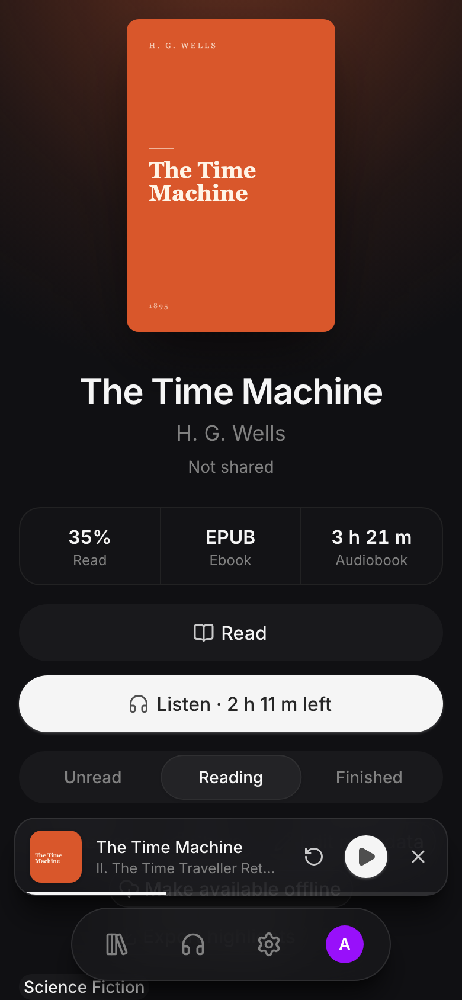
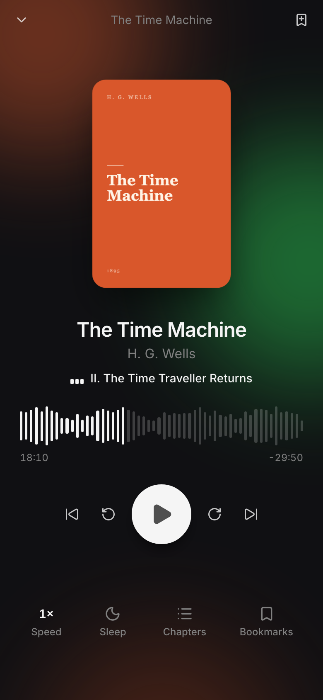

<p align="center">
  
</p>

<h1 align="center">Papyrus</h1>

<p align="center">
  <a href="https://github.com/rixcian/papyrus/actions/workflows/ci.yml"></a>
  <a href="https://github.com/rixcian/papyrus/actions/workflows/ci.yml"></a>
  <a href="https://github.com/rixcian/papyrus/pkgs/container/papyrus"></a>
  
  
</p>

<p align="center">
  A self-hosted library, reader and audiobook player for your household.<br>
  <b>epub</b> · <b>mobi</b> · <b>azw3</b> · <b>mp3</b> · <b>m4a</b> · <b>m4b</b>
</p>

<p align="center">
  One Docker image serves the API and the web app, which you can install on phones and computers and use offline.
</p>

<table align="center">
  <tr>
    <td align="center">
      
      <br><sub>Library</sub>
    </td>
    <td align="center">
      
      <br><sub>A Book with an ebook and an audiobook</sub>
    </td>
    <td align="center">
      
      <br><sub>Audiobook player</sub>
    </td>
  </tr>
  <tr>
    <td align="center">
      
      <br><sub>Reader</sub>
    </td>
    <td align="center">
      
      <br><sub>Highlights and Bookmarks</sub>
    </td>
    <td align="center">
      
      <br><sub>Library grid</sub>
    </td>
  </tr>
</table>

## Features

- 📚 **Library**: upload or drop in books; metadata and covers are read from the files. Search, filter by author, series, tag, shelf and Read Status, in a grid or a list.
- 📖 **Reader**: themes, fonts, paginated or scrolling, contents, search inside the book, Bookmarks, Highlights with Notes, Markdown export, and translating a selection (with DeepL).
- 🎧 **Audiobooks**: an audiobook is another File of a Book, next to its epub. Chapters, speed, a sleep timer, Bookmarks, lock-screen controls, and a mini-player that keeps playing while you browse.
- 👨‍👩‍👧 **Profiles**: everyone in the household gets their own library, progress and highlights. Books can be Shared with other Profiles.
- 🔄 **Sync**: reading position, Highlights and Bookmarks follow you between devices, and work offline.
- 📥 **Import folder**: drop files, or a whole Calibre library, into a folder and they are imported.
- 🔎 **Find online**: fill in missing details and covers from Open Library.

> [!WARNING]
> **Papyrus has no login.** Profiles are for keeping libraries apart, not for security: anyone who can reach the server can open every Profile and change or delete anything. Run it on a private network (your LAN, Tailscale, a VPN), or put authentication in front of it, as in the Caddy example below.

## Running it

### Docker

```sh
docker run -d --name papyrus \
  -p 8080:8080 \
  -v papyrus-data:/data \
  ghcr.io/OWNER/papyrus:latest
```

Replace `OWNER` with the GitHub user or organisation that publishes the image. Then open <http://localhost:8080> and create the first Profile.

### Docker Compose with HTTPS

The installable app and Offline Books need HTTPS: browsers only allow service workers and offline storage on secure origins (`localhost` is the exception). The example puts [Caddy](https://caddyserver.com) in front, which gets and renews a certificate for your domain.

```sh
cp docker-compose.example.yml docker-compose.yml
cp Caddyfile.example Caddyfile   # set your domain, and optionally basic_auth
mkdir import
docker compose up -d
```

On Tailscale, `tailscale serve --bg 8080` gives you HTTPS on your tailnet without Caddy.

### Image tags

| Tag            | What                                    |
| -------------- | --------------------------------------- |
| `latest`       | The newest release                      |
| `X.Y.Z`, `X.Y` | A release                               |
| `main`         | The newest commit on the default branch |
| `sha-<commit>` | One commit                              |

Images are built for `linux/amd64`.

The version is the `version` in the root `package.json`. To release, bump it (`X.Y.Z`, following semver) and push to the default branch: the first image built with a version that isn't in GHCR yet is also tagged `X.Y.Z`, `X.Y` and `latest`. A prerelease such as `0.2.0-beta.1` gets only its own tag.

## Configuration

Everything is set with environment variables; all are optional.

| Variable                       | Default   |                                                                |
| ------------------------------ | --------- | -------------------------------------------------------------- |
| `PORT`                         | `8080`    | Port to listen on                                              |
| `HOST`                         | `0.0.0.0` | Address to listen on                                           |
| `PAPYRUS_DATA_DIR`             | `/data`   | Database, book files and covers. Mount a volume here.          |
| `PAPYRUS_IMPORT_DIR`           | unset     | Turns on the import folder (see below)                         |
| `PAPYRUS_IMPORT_POLL_SECONDS`  | `30`      | How often the import folder is checked                         |
| `PAPYRUS_IMPORT_DELETE_SOURCE` | `false`   | Delete files from the import folder once imported              |
| `PAPYRUS_MAX_UPLOAD_MB`        | `2048`    | Largest file that can be uploaded (each file of an audiobook)  |
| `PAPYRUS_TRUST_PROXY`          | `false`   | Set to `true` behind a reverse proxy                           |
| `PAPYRUS_DEEPL_API_KEY`        | unset     | Turns on translating selections in the reader                  |
| `LOG_LEVEL`                    | `info`    | `fatal`, `error`, `warn`, `info`, `debug`, `trace` or `silent` |

### Import folder

With `PAPYRUS_IMPORT_DIR=/import` (mount a host folder there), each Profile gets its own folder, `/import/<Profile name>/`. It is created with the Profile and renamed with it. Anything you put in it, in any sub-folder, is imported into that Profile's library once it has stopped changing:

- epub, mobi and azw3 become readable Books. Other files (pdf, cbz, …) are kept as downloadable Files.
- Audio files in one folder become one audiobook, grouped by their album tag and ordered by disc, track number and file name. Loose untagged recordings at the top of your folder are each their own audiobook. A folder is imported once all of its audio has stopped changing; if you replace a recording later, the audiobook is imported again into the same Book.
- A folder containing a `metadata.opf` is treated as a Calibre book: all of its files become one Book, with the title, authors, series and tags from the OPF and the cover from `cover.jpg`. To bring in a Calibre library, copy it (or point the mount) into your Profile's folder.
- A file is imported once. Deleting the Book in Papyrus doesn't bring it back; changing the file does.
- Results and failures are listed in **Settings → Imports**.

### Audiobooks

- **Formats**: mp3, m4a and m4b are stored and streamed as they are, with no conversion. ogg/opus are stored too, but not every browser plays them (Safari on iOS doesn't play all of them).
- **Adding**: upload a single m4b, or select all the mp3s of a book together. Files picked together that share an album tag become one audiobook, so the upload limit applies to each file, not the whole book. The title, author, year, genre and cover come from the tags. An audiobook whose title and author match an ebook you already have is added to that Book.
- **Chapters**: m4b chapters (and mp3 chapter frames) are used when present; otherwise each file is a chapter.
- **Progress**: listening position syncs between devices like reading progress. A Book counts as finished in the last 30 seconds of the recording. Speed is remembered per Profile on each device.
- **Offline**: "Make available offline" downloads the whole audiobook (it tells you the size first). Seeking works offline.
- **Phones**: lock-screen and headphone controls use the Media Session API. Playing in the background depends on the browser; it hasn't been tested on iOS yet.
- **Downloading**: an audiobook made of several files downloads as a zip.

### Translation

Selecting text in the reader offers **Translate** when `PAPYRUS_DEEPL_API_KEY` is set. Get a key at [deepl.com](https://www.deepl.com/pro-api); the free plan allows 500,000 characters a month, and its keys (ending in `:fx`) are recognised automatically. The key stays on the server. Each Profile picks its target language in the reader; Czech is the default.

The selected text is sent to DeepL. Without a key, the button doesn't appear.

### Find online

**Edit metadata → Find online** asks [Open Library](https://openlibrary.org) for details and covers, through the server. The title, author or ISBN you search for is sent to Open Library; nothing is changed until you pick what to copy and save.

## Your data and backups

Everything lives in `/data`:

| Path                            |                                                                                                       |
| ------------------------------- | ----------------------------------------------------------------------------------------------------- |
| `papyrus.db` (+ `-wal`, `-shm`) | The SQLite database: Profiles, Books, Shares, shelves, reading progress, Highlights                   |
| `blobs/`                        | Book files and audiobook recordings, stored once per content, named by their SHA-256. Never modified. |
| `covers/`                       | Cover images                                                                                          |

Papyrus doesn't make backups itself. Two ways to take one:

- **Stop and copy**: `docker compose stop papyrus`, copy the whole `/data` volume, start it again.
- **While running**: write a consistent copy of the database, then copy `/data` (the book files never change once written, so copying them while running is safe):

  ```sh
  docker compose exec papyrus node -e "require('better-sqlite3')('/data/papyrus.db', { readonly: true }).backup('/data/papyrus-backup.db').then(() => console.log('done'))"
  ```

  Back up `papyrus-backup.db` with `blobs/` and `covers/`. To restore, stop Papyrus, put the files back, and rename the backup to `papyrus.db` (removing any `papyrus.db-wal` and `papyrus.db-shm`).

Reading progress, Highlights and Bookmarks made offline live on the device until it next syncs.

## Updating

Pull the new image and restart; database migrations run on start, and the server refuses to start if one fails. Open apps show "A new version of Papyrus is ready" and reload when you choose, never in the middle of a chapter.

## Development

Requirements: Node 24 and pnpm (`corepack enable`).

```sh
pnpm install
pnpm dev          # API on :8080 and the web app on :5173 (open this one)
```

| Command              |                                                                            |
| -------------------- | -------------------------------------------------------------------------- |
| `pnpm check`         | Biome lint and format check (`pnpm format` fixes)                          |
| `pnpm typecheck`     | TypeScript in every package                                                |
| `pnpm test`          | Vitest unit and API tests                                                  |
| `pnpm test:coverage` | The same, with a coverage report in `coverage/`                            |
| `pnpm build`         | Build the web app and the server bundle                                    |
| `pnpm e2e`           | Playwright end-to-end tests against the built app (run `pnpm build` first) |
| `pnpm gen:api`       | Regenerate the web app's API types after changing a server route           |

The service worker only runs in a production build; `pnpm dev` doesn't register it.

The README screenshots are made by `scripts/screenshots.ts`: it starts the built app on a throwaway data folder, fills it with public-domain classics and an audiobook (needs ffmpeg), and photographs it at phone size. After a visible change, run `pnpm build && node scripts/screenshots.ts` and commit `docs/screenshots/`.

Layout:

- `apps/server`: Fastify API, SQLite with Drizzle migrations in `apps/server/drizzle/`.
- `apps/web`: React app (Vite), with [foliate-js](https://github.com/johnfactotum/foliate-js) vendored in `src/vendor/` for reading.
- `packages/shared`: code both sides use (sync clock, CFI ordering, limits).
- `e2e`: the Playwright tests, with fake Open Library and DeepL servers so they run offline.
- Audio test fixtures in `apps/server/src/test/fixtures/audio` are made by `apps/server/scripts/make-audio-fixtures.sh` (needs ffmpeg) and committed, so tests don't need ffmpeg.

The words the code and docs use (Profile, Book, File, Share, Offline Book, …) are defined in [`GLOSSARY.md`](GLOSSARY.md); decisions that are hard to reverse are in [`docs/adr/`](docs/adr/).

CI (`.github/workflows/ci.yml`) runs the checks, tests and end-to-end test on every push and pull request, and publishes the image to GHCR from the default branch, as a release when the `package.json` version is new (see [Image tags](#image-tags)).
